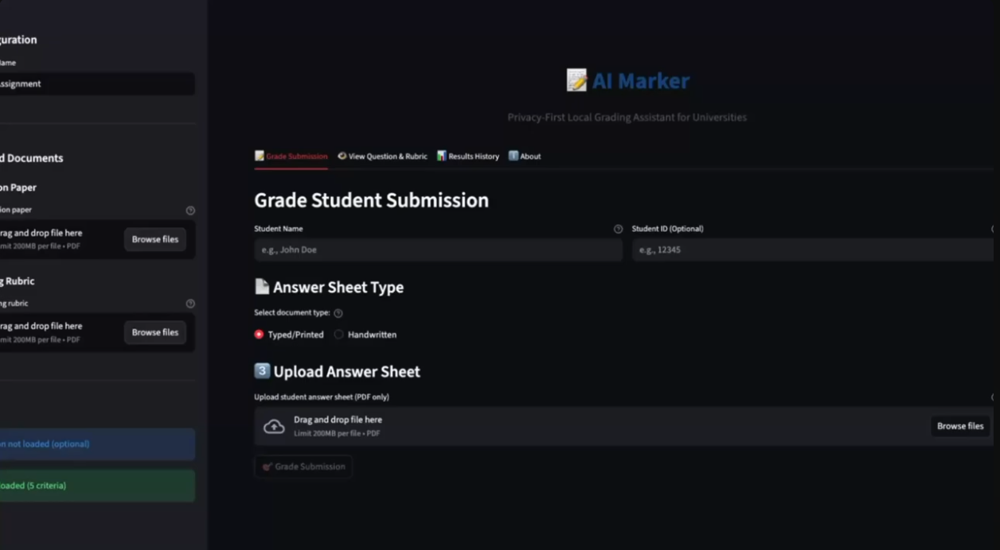

# 🧠 AI Marker - Local Automated Grading Assistant

A **privacy-first Streamlit application** that uses local LLM models to
grade student submissions against rubrics.

Designed for university teachers who want AI-assisted grading **without
compromising student data privacy**.

All processing happens locally to maintain FERPA compliance and
institutional data security.

------------------------------------------------------------------------

## 📌 Features

-   Local LLM-based grading
-   Rubric-based structured evaluation
-   Handwriting recognition (OCR via vision model)
-   Detailed AI-generated feedback
-   Professional PDF feedback reports
-   Results history with JSON export
-   Fully offline processing

------------------------------------------------------------------------

## 🛠️ Prerequisites

Ensure you have:

-   Python 3.9 or higher
-   Ollama (installed and running)
-   pip (Python package manager)

------------------------------------------------------------------------

## 🤖 Required Models

Pull models based on your hardware capacity:

### Grading Model (Choose One)

``` bash
ollama pull llama3.1:8b       # Minimum: 16GB RAM
ollama pull llama3.1:70b      # Recommended: 64GB RAM
```

Alternative supported models: - llama3.1 (8B / 70B) - qwen2.5

### Vision Model (Handwriting OCR)

``` bash
ollama pull llama3.2-vision:11b
```

------------------------------------------------------------------------

## ⚙️ Setup Instructions

### 1. Clone Repository

``` bash
git clone <your-repo-url>
cd ai-marker
```

### 2. Create Virtual Environment

``` bash
python -m venv venv

# macOS / Linux
source venv/bin/activate

# Windows
venv\Scripts\activate
```

### 3. Install Dependencies

``` bash
pip install -r requirements.txt
```

### 4. Run Application

Ensure Ollama is running:

``` bash
ollama serve
```

Launch Streamlit:

``` bash
streamlit run streamlit_app.py
```

Open in browser:

http://localhost:8501

------------------------------------------------------------------------

## 🔧 Optional Configuration

You can customize model and GPU settings by creating a `.env` file in
the root directory.

Example:

    OLLAMA_MODEL=llama3.1:8b
    VISION_MODEL=llama3.2-vision:11b
    USE_GPU=true

------------------------------------------------------------------------

# 🧑‍🏫 User Guide

## 1️⃣ Initial Setup (Sidebar)

After launching the app:

-   Enter **Assignment Name**
-   Upload **Question Paper**
-   Upload **Grading Rubric** (PDF or image)
-   Click **"Process Question & Rubric"**

The system structures evaluation criteria automatically.

------------------------------------------------------------------------

## 2️⃣ Grade Student Submissions

Navigate to the main grading tab:

-   Enter **Student Name and ID**
-   Upload **Answer Sheet (PDF)** (supports scanned handwriting)
-   Click **"Grade Submission"**

The system will:

1.  Perform OCR (if handwritten)
2.  Extract student text
3.  Compare against rubric
4.  Generate score and feedback

------------------------------------------------------------------------

## 3️⃣ Review & Export

### Detailed Feedback

Review AI-generated strengths and improvement areas.

### PDF Reports

Download professional feedback documents for students.

### Results History

Use the **Results History** tab to:

-   View grading session statistics
-   Export results as JSON

------------------------------------------------------------------------

## 📸 UI Overview

The interface provides a split-view:

-   Extracted student text
-   AI-generated scoring and rubric evaluation

------------------------------------------------------------------------

## 🎥 Demo Video

(Add your demo video link here)

------------------------------------------------------------------------

# 🛠️ Troubleshooting

### ❌ "Cannot connect to Ollama"

Run:

``` bash
ollama serve
```

------------------------------------------------------------------------

### ❌ "Out of Memory"

-   Pull a smaller model:

``` bash
ollama pull llama3.1:8b
```

-   Update `.env` to use the smaller model

------------------------------------------------------------------------

### ❌ Poor OCR Accuracy

-   Ensure scans are at least **300 DPI**
-   Ensure handwriting is legible
-   llama3.2-vision performs best with clear, well-lit scans

------------------------------------------------------------------------

## Demo Video

Watch the demo of the application:

[](https://youtu.be/o-1gsWQgImw)

------------------------------------------------------------------------

Developed by Ashween R
